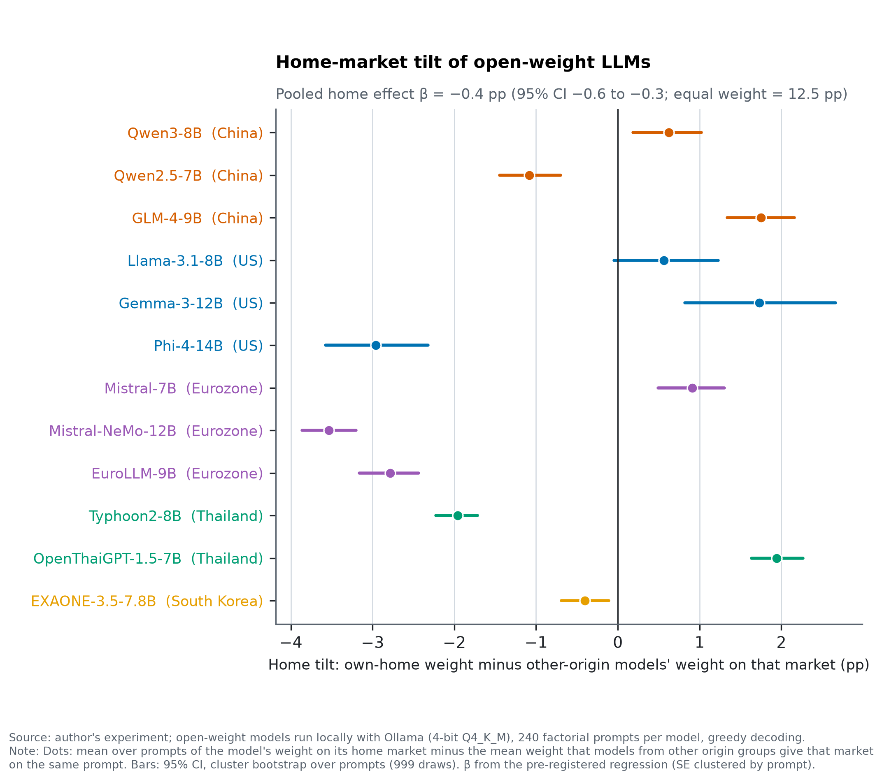

<h1 align="center">Do Open-Source LLMs Have a Home Bias?</h1>
<p align="center"><b>Investment advice from Chinese, American, European and Thai models</b></p>

[](https://github.com/<my-handle>/llm-home-bias/actions/workflows/ci.yml)
[](paper/paper.pdf)
[](docs/PAP.md)
[](DATASET_CARD.md)
[](LICENSE)

📄 **[PDF](paper/paper.pdf)** · 📝 **[Pre-analysis plan](docs/PAP.md)** · 📓 **[Research log](docs/FINDINGS.md)** · 🗂️ **[Dataset card](DATASET_CARD.md)** · 🇹🇭 **[สรุปภาษาไทย](docs/SUMMARY_TH.md)**

**Takeaway:** we tested 12 open-weight LLMs on the same prompts. On average, a model does **not** allocate more to its home stock market than other models allocate to that market. The pre-registered home effect is **β = −0.42 pp** (95% CI −0.59 to −0.25), against an equal weight of 12.5 pp. What the investor says about themselves moves the allocation 4.4 times as much.

<p align="center"></p>

## Abstract

Do open-weight language models put more of an equity portfolio into the stock market of the country where they were built? We asked 12 models, run locally, to split a portfolio across eight markets: the United States, China, the Eurozone, Japan, the United Kingdom, India, South Korea and Thailand. The models come from China, the United States, Europe, Thailand and Korea. Each model answered the same 240 factorial prompts, which vary the investor's residence, the prompt language, risk tolerance and horizon.

In the pre-registered regression, a model's home market receives −0.42 pp relative to what other models give that market. That is no home tilt, and if anything a small negative one. A post-hoc check that allows for models' different dispersion around equal weight puts the effect at +0.12 pp. The investor's stated residence is associated with a much larger shift, +1.88 pp. Thai fine-tuning moves the Thailand weight by −1.04 pp in one pair and +1.26 pp in the other. All replies and code are public.

## Why this matters

Language models are entering retail financial advice and research workflows. Central banks have started to map how AI changes intermediation and asset management (Aldasoro et al., 2024; BIS, 2024). Suppose a model systematically allocated more to one country's assets. That tilt would reach every user who asks the model, much as investor home bias shapes portfolios one investor at a time (French & Poterba, 1991; Lewis, 1999; Coval & Moskowitz, 1999).

Language models also carry geographic and cultural slants. Their default answers resemble the values of English-speaking and Protestant European countries (Tao et al., 2024; Durmus et al., 2024). Their ratings of places are systematically lower for regions with weaker socioeconomic conditions (Manvi et al., 2024).

In finance, a recent audit of 32 models finds advice consistent with investor home bias (Fieberg et al., 2025). Another finds three commercial chat assistants putting over 90% of equity portfolios in the United States (Winder et al., 2025). Whether such advice can be trusted to fiduciary standards is still open (Lo & Ross, 2024).

Those audits vary the investor, not the model's origin. We ask the complementary question: **holding the prompt fixed, does a model allocate more to its own home market?** The prompt also states the investor's residence and comes in four languages. That lets the design separate three channels that ordinary use mixes together: the model's origin (β), the investor's residence (γ) and the prompt language (λ).

## Design

**Models.** We ran 12 open-weight instruction-tuned models through Ollama at 4-bit quantisation (Q4_K_M) on a single RTX 4070 Ti. The full list is in [table 2](output/tables/table2_models.md). A model's home market is its lead developer's country:

| Origin | Models | Home market |
|---|---|---|
| China | Qwen3-8B, Qwen2.5-7B, GLM-4-9B | China |
| United States | Llama-3.1-8B, Gemma-3-12B, Phi-4 | United States |
| Europe | Mistral-7B, Mistral-NeMo-12B, EuroLLM-9B | Eurozone |
| Thailand | Typhoon2-8B, OpenThaiGPT-1.5-7B | Thailand |
| Korea | EXAONE-3.5-7.8B | South Korea |

The two Thai models are fine-tunes of Llama-3.1-8B and Qwen2.5-7B. Both base models are also in the sample.

**Prompts.** Every model answered the same 240 prompts. They cross five factors:

- investor residence: US, China, France, Thailand, or unspecified;
- prompt language: English, Chinese, French, Thai;
- risk tolerance: three levels;
- horizon: 3 or 20 years;
- two paraphrases.

Each prompt asks for 100 points split across a fixed menu of eight markets: the United States, China, the Eurozone, Japan, the United Kingdom, India, South Korea and Thailand. Japan, the UK and India are nobody's home market. Menu order is randomised in Latin-square blocks, so every market appears in every position exactly 30 times. Replies are constrained to a JSON schema with eight integer weights, a cash currency and a reason of at most 30 words. Decoding is greedy (temperature 0, seed 42).

**Estimation.** We regress the weight w (pp) on the model × prompt × market panel:

```
w = α_model + α_market + β·Home + γ·InvestorHome + λ·LanguageHome + menu-position dummies
```

Standard errors are clustered by prompt (240 clusters). We also report a wild cluster bootstrap over the 8 templates.

**Pre-registration.** The [pre-analysis plan](docs/PAP.md) and the prompt set's SHA-256 were committed before the full run. It fixes three hypotheses:

- **H1:** β > 0.
- **H2:** β > 0 among English prompts with an unspecified investor.
- **H3:** each Thai fine-tune allocates more to Thailand than its base model does.

One amendment (A1) was made after a 20-prompt pilot and before the full run. Replies that still miss a 95–105 total after one retry are renormalised instead of dropped. The original rule is kept as a robustness check.

## Results

**The instrument works.** Refusals are at most 0.4% per model and parse failures at most 0.8%, so no model is excluded. Many replies get the arithmetic wrong. For the median model, 15.6% of replies are still outside 95–105 after one retry; for EuroLLM the figure is 82.5% ([fig. 5](output/figures/fig5_refusal_parse_rates.png)).

**No home tilt (H1 not supported).** A model's home market receives **β = −0.42 pp** (SE 0.09). The wild template bootstrap 95% CI is −0.75 to −0.09. The effect is small and has the opposite sign to H1.

Per model, the home tilt ranges from −3.5 to +1.9 pp. Five models allocate significantly more to their home market than other models do, and six allocate significantly less. There is no consistent pattern within origin groups. By origin group (pp, SE in brackets):

| Origin group | Extra weight on own home market (pp) |
|---|---|
| Chinese models → China | +0.60 (0.15) |
| European models → Eurozone | −2.07 (0.13) |
| US models → United States | −0.17 (0.26) |
| Thai models → Thailand | +0.07 (0.12) |
| Korean model → South Korea | −0.40 (0.16) |

H2 is not supported either. Among English prompts with no investor nationality, β = −1.02 pp (SE 0.29; 12 prompts).

| [Table 1](output/tables/table1_primary.md) | Estimate (pp) | SE |
|---|---|---|
| β Home (model origin) | −0.42 | 0.09 |
| γ InvestorHome (investor's stated residence) | +1.88 | 0.21 |
| λ LanguageHome (prompt language) | +0.46 | 0.13 |
| H2: English, unspecified investor | −1.02 | 0.29 |
| H3: Typhoon2 vs Llama-3.1 (Thailand weight) | −1.04 | 0.26 |
| H3: OpenThaiGPT vs Qwen2.5 (Thailand weight) | +1.26 | 0.27 |
| Cash: home-currency premium (pp of probability) | −2.18 | 0.48 |

**The prompt matters more than the model's origin.** When the investor states a country of residence, that market receives **+1.88 pp** more. Writing the prompt in a market's main language adds +0.46 pp ([fig. 3](output/figures/fig3_origin_vs_language_vs_investor.png)).

Allocation levels are far from both market-cap and GDP weights ([fig. 2](output/figures/fig2_allocation_heatmap.png)). Every model gives the United States 7.9–22.7%, against 75.5% in MSCI ACWI renormalised over the eight markets. Every model gives China 13.7–22.5%, against 2.5% in ACWI. All models sit much closer to equal weight than to any capitalisation benchmark.

**Fine-tuning (H3 mixed).** The two Thai fine-tunes move in opposite directions ([fig. 4](output/figures/fig4_finetune_transmission.png)):

- OpenThaiGPT allocates **+1.26 pp** more to Thailand than its base Qwen2.5-7B (9.2% vs 8.0%).
- Typhoon2 allocates **−1.04 pp** relative to Llama-3.1-8B (5.3% vs 6.4%).

Fine-tuning on Thai data is therefore not associated with a consistent shift towards Thailand.

**Cash.** Every model chooses US dollars for cash in 80.4–96.7% of replies. The home-currency premium is −2.18 pp. The high home-currency share of US models is the common dollar default, not a home effect.

## Robustness

[Table 3](output/tables/table3_robustness.md) reports β under each pre-registered check (pp unless noted):

| Check | β |
|---|---|
| Temperature 0.7, two seeds (60-prompt subset) | −0.17 (95% CI −0.48 to 0.13) |
| Greedy, same 60-prompt subset | −0.37 |
| No system prompt (60-prompt subset) | −0.65 |
| Only replies summing to exactly 100 | −0.67 |
| Original 95–105 rule (4 models excluded) | −0.33 |
| English prompts only | −0.70 |
| Unspecified investor only | −0.64 |
| Log-ratio outcome (log units) | −0.026 |
| Leave one model out | −0.82 to −0.01 |

The point estimate is negative in every check. It is not significant under temperature-0.7 sampling, and it loses significance without Typhoon2, Phi-4 or Mistral-NeMo, so the negative sign rests on a few models and on greedy decoding. No check shows a positive home tilt.

**Post hoc** (not pre-registered): models differ in how far they stay from equal weight. A model that sits close to 12.5% everywhere mechanically gives less than other models to popular markets. Allowing each model its own slope on market popularity gives β = +0.12 pp (95% CI −0.08 to 0.32). Under either reading, there is no positive home tilt larger than about a third of a percentage point.

## What this does not show

- **Not frontier models.** These are 12 small open-weight models (7–15 B parameters) at 4-bit quantisation. Frontier API models, larger checkpoints and full-precision weights may behave differently.
- **One instrument.** The eight-market menu, the templates and their machine-assisted translations are one instrument among many. A different menu, a request for a single-country recommendation, or templates written by native speakers could change the picture.
- **Greedy decoding.** Each estimate describes a model's most likely reply, not the spread of replies a user would actually get.
- **Coarse origin.** Origin means the lead developer's country. Mistral-NeMo was co-developed with NVIDIA, and fine-tunes inherit most of their base model.
- **No claim about intent, training data or advice quality.** An allocation can show no home tilt and still be far from any sensible benchmark, as these are.

## Reproduce

```bash
make venv                 # Python 3.12 virtualenv with pinned requirements
make all                  # rebuild every number, table and figure from the cached replies (< 1 min, no GPU)
make run && make robust   # regenerate the replies: needs Ollama and the 12 models in config.yaml (≈ 3.5 h on an RTX 4070 Ti)
make paper                # PDF (pinned Tectonic) and web reader
```

The raw replies (`data/responses/*.jsonl`), the parsed panel (`data/processed/*.parquet`) and the prompt set are in this repository. They are documented in [DATASET_CARD.md](DATASET_CARD.md). Every number in the PDF is generated from `output/tables/results.json`.

The study was carried out with Claude (Anthropic) via Claude Code, working from the author's written brief. The author directed the work and is responsible for the content.

## References

- Aldasoro, I., Gambacorta, L., Korinek, A., Shreeti, V. & Stein, M. (2024). *Intelligent financial system: how AI is transforming finance.* BIS Working Papers No 1194.
- BIS (2024). Artificial intelligence and the economy: implications for central banks. *Annual Economic Report 2024*, ch. III.
- Coval, J. D. & Moskowitz, T. J. (1999). Home bias at home: local equity preference in domestic portfolios. *Journal of Finance* 54(6), 2045–2073.
- Durmus, E. et al. (2024). Towards measuring the representation of subjective global opinions in language models. *COLM 2024* (arXiv:2306.16388).
- Fieberg, C., Hornuf, L., Meiler, M. & Streich, D. (2025). *Using large language models for financial advice.* CESifo Working Paper No 11666.
- French, K. R. & Poterba, J. M. (1991). Investor diversification and international equity markets. *American Economic Review* 81(2), 222–226.
- Lewis, K. K. (1999). Trying to explain home bias in equities and consumption. *Journal of Economic Literature* 37(2), 571–608.
- Lo, A. W. & Ross, J. (2024). Can ChatGPT plan your retirement? Generative AI and financial advice. *Harvard Data Science Review*, Special Issue 5.
- Manvi, R., Khanna, S., Burke, M., Lobell, D. & Ermon, S. (2024). Large language models are geographically biased. *ICML 2024*, PMLR 235.
- Tao, Y., Viberg, O., Baker, R. S. & Kizilcec, R. F. (2024). Cultural bias and cultural alignment of large language models. *PNAS Nexus* 3(9), pgae346.
- Winder, P., Hildebrand, C. & Hartmann, J. (2025). Biased echoes: large language models reinforce investment biases and increase portfolio risks of private investors. *PLOS One* 20(6), e0325459.

Full BibTeX entries are in [paper/refs.bib](paper/refs.bib). Cite this work via [CITATION.cff](CITATION.cff).
